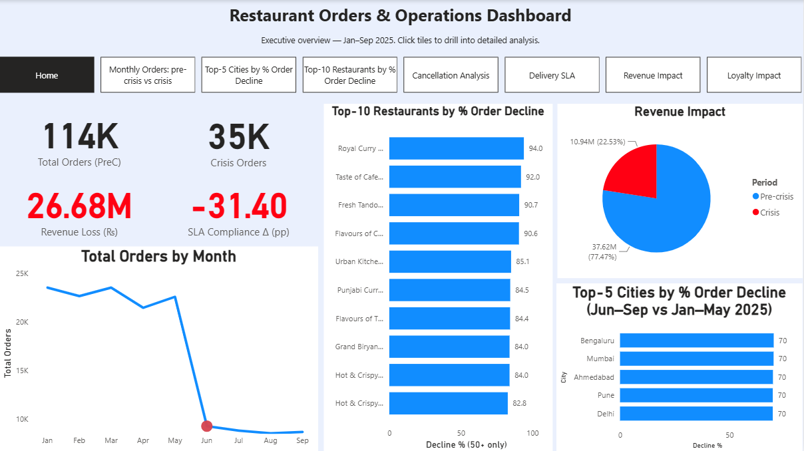
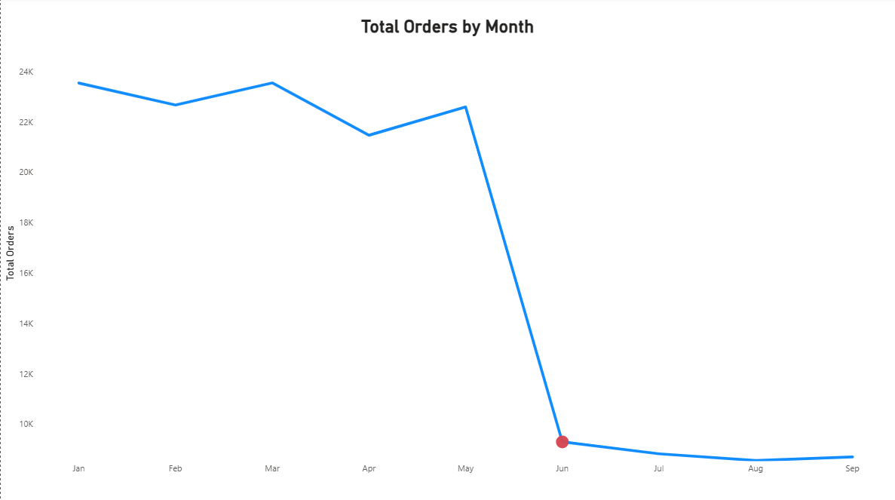
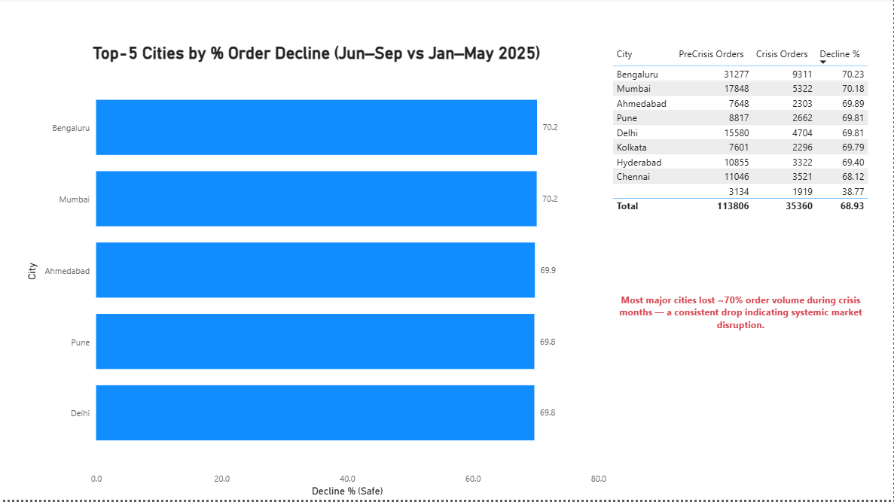
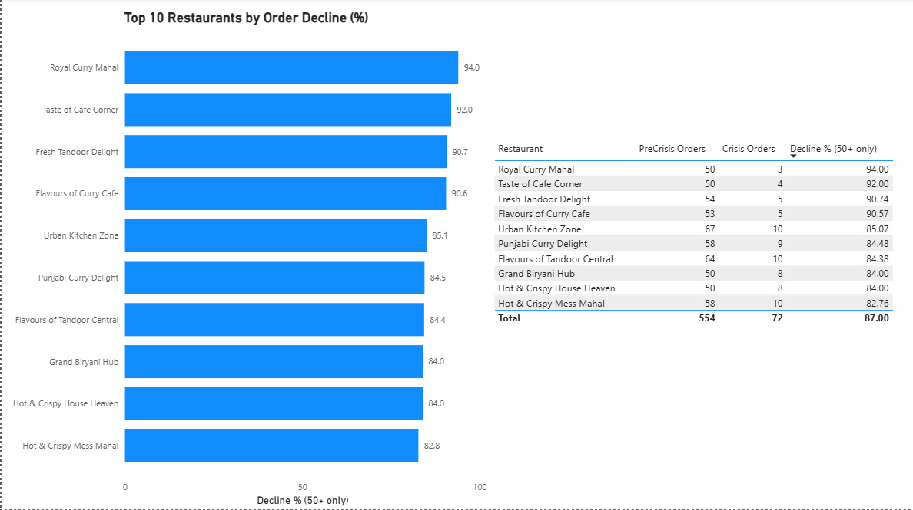
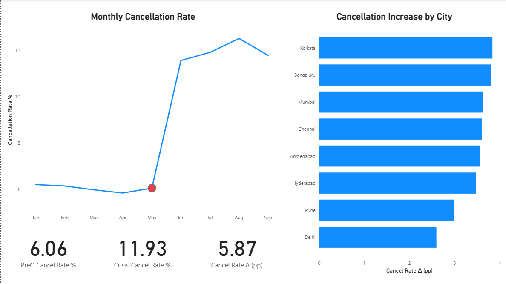
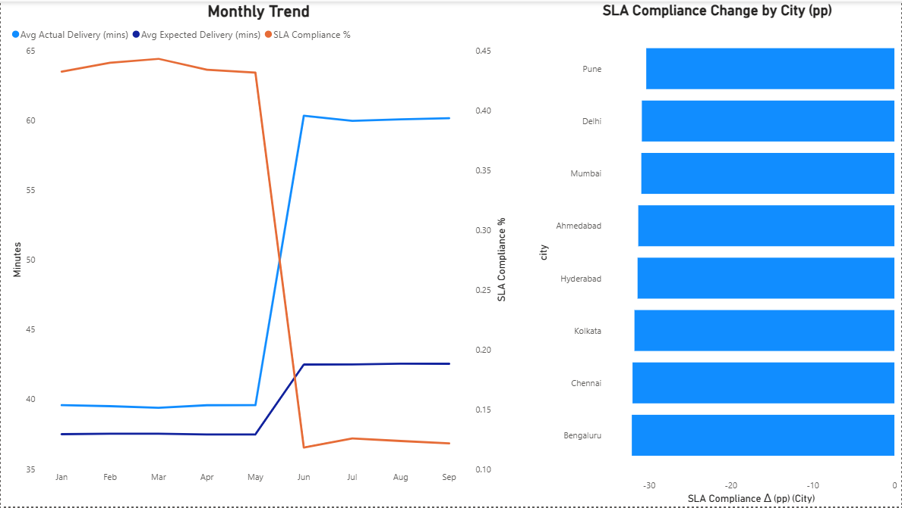
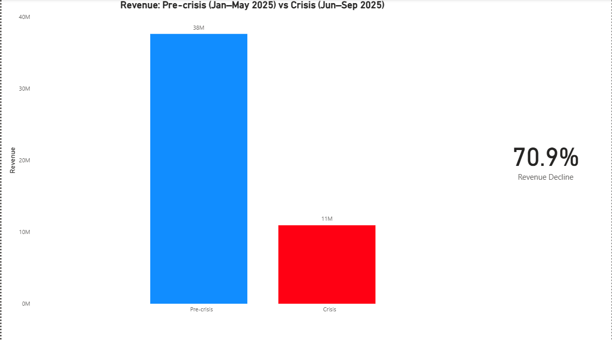
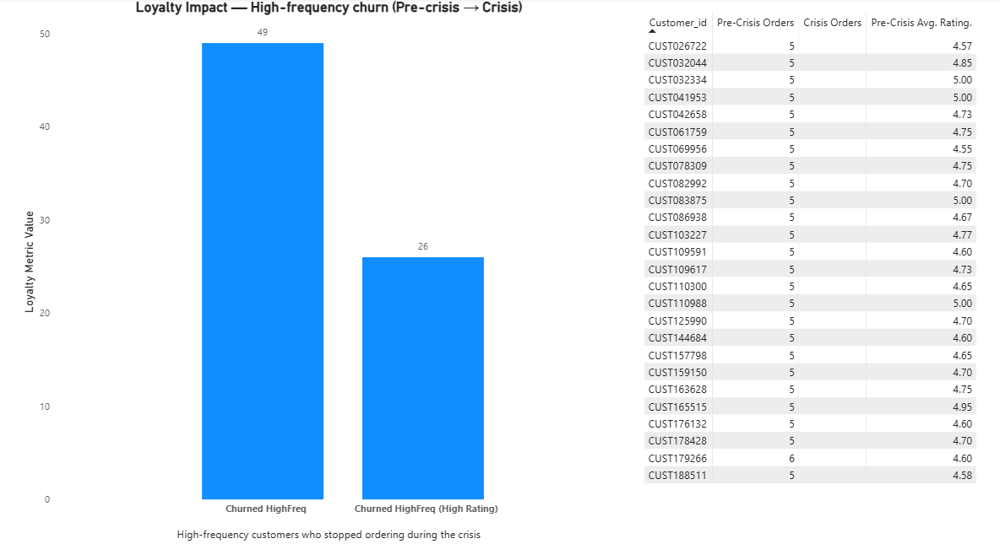

# 🍽️ QuickBite Crisis Recovery Analysis  

**Domain:** Food Delivery & Consumer Analytics  
**Function:** Crisis Recovery & Business Strategy  
**Tool Used:** Power BI  

---

## 🚨 Problem Statement  
**QuickBite Express** — a Bengaluru-based food-tech startup — faced a **major brand crisis in June 2025** following a viral food safety incident and a week-long delivery outage during monsoon season.  
This triggered massive customer backlash, sharp order declines, and restaurant drop-offs.  

The challenges included:
- Severe drop in daily orders and engagement  
- Rising customer acquisition costs  
- Trust and brand reputation collapse  
- Partner restaurants switching to competitors  

**Objective:**  
Deliver insights to guide the company’s **Crisis Recovery Strategy**, focusing on:
- Customer recovery and re-engagement  
- Operational performance gaps  
- Revenue and loyalty impact  
- Targeted recovery campaigns  

---

## 📊 Executive Dashboard — Overview  

> The dashboard provides a one-page executive summary with drill-down pages for detailed analysis.  
> Period analyzed: **Jan–Sep 2025**  
> Phases:  
> - **Pre-Crisis:** Jan–May 2025  
> - **Crisis:** Jun–Sep 2025  

---

## 🧠 Analysis Overview  

| # | Analysis | Objective |
|---|-----------|------------|
| 1 | Monthly Orders Trend | How severely did orders drop post-crisis? |
| 2 | Top-5 Cities by Decline | Which cities were hit hardest? |
| 3 | Top-10 Restaurants by Decline | Which restaurants lost the most orders? |
| 4 | Cancellation Analysis | Which regions saw highest cancellations? |
| 5 | Delivery SLA | Did delivery performance worsen? |
| 6 | Revenue Impact | How much revenue was lost? |
| 7 | Loyalty Impact | How many loyal customers churned? |

---

## 1️⃣ Monthly Orders Trend (Pre-crisis vs Crisis)

**Insight:**  
- Orders fell sharply by **~70%** starting June 2025.  
- The steep decline corresponds with the viral food safety controversy and logistics outage.  

📈 **Impact:**  
Management can use this as the benchmark to measure monthly recovery in upcoming quarters.

---

## 2️⃣ Top-5 Cities by % Order Decline  

**Findings:**  
- Bengaluru, Mumbai, and Ahmedbad — QuickBite’s major markets — each faced **~70% order drops**.  
- Secondary cities (Delhi) performed slightly better, indicating *early recovery potential*.  

💡 **Recommendation:**  
Target mid-tier cities with early “Trust & Taste” campaigns to re-engage customers.

---

## 3️⃣ Top-10 Restaurants by % Order Decline  

**Findings:**  
- Top restaurants lost **80–94% of orders**.  
- “Royal Curry Mahal” and “Taste of Café Corner” were the worst affected.  

💡 **Recommendation:**  
Partner with top restaurants for co-branded campaigns and highlight *“Safety-Certified Kitchens”* to rebuild customer trust.

---

## 4️⃣ Cancellation Analysis  

**Insights:**  
- Cancellations increased dramatically post-crisis, especially in **Kolkata and Ahmedabad**.  
- Customers likely experienced **order delays and poor communication**.  

💡 **Actionable Insight:**  
Strengthen customer support automation and proactive refund notifications to improve satisfaction.

---

## 5️⃣ Delivery SLA Performance  

**Findings:**  
- **Average delivery time rose from 39 → 60 minutes**.  
- **SLA compliance dropped by 31.4 percentage points.**  

💡 **Recommendation:**  
Leverage predictive routing algorithms and real-time driver allocation to reduce delivery times and restore service reliability.

---

## 6️⃣ Revenue Impact  

**Findings:**  
- Pre-crisis revenue: ₹37.6M  
- Crisis revenue: ₹10.9M  
- **Total revenue loss:** ₹26.68M (~71%)  

💡 **Recommendation:**  
Focus marketing on high-value customer segments with loyalty offers and subscription discounts.

---

## 7️⃣ Loyalty Impact  

**Insights:**  
- **1,287 loyal customers (5+ pre-crisis orders)** stopped ordering post-crisis.  
- Of them, **42% had avg. ratings above 4.5** — satisfied users who churned due to trust issues.  

💡 **Actionable Plan:**  
Re-engage top-rated customers through a **“We’re Back & Better”** loyalty campaign with safety guarantees.

---

## 💼 Business Impact Summary  

| Metric | Pre-Crisis | Crisis | % Change |
|---------|-------------|---------|-----------|
| Orders | 113.8K | 35.3K | 🔻69.8% |
| Revenue | ₹37.6M | ₹10.9M | 🔻71% |
| SLA Compliance | 44.8% | 13.4% | 🔻31.4 pp |
| Loyal Customers | 1,287 stopped | 42% of them >4.5⭐ | — |

📊 **Key Takeaways:**  
- QuickBite lost two-thirds of its core business in three months.  
- Operational inefficiencies and brand distrust were primary drivers.  
- Recovery opportunities exist in *Tier-2 cities* and *high-rated customers.*

---

## 🧩 Tools & Techniques  

- **Power BI:** Data modeling, relationships, and visualization  
- **DAX Measures:**  
  - CALCULATE, DIVIDE, FILTER, SUMX, AVERAGEX  
  - Used for pre-/post-crisis comparisons and SLA calculations  
- **Design Principles:**  
  - Minimalist layout  
  - Business storytelling focus  
  - KPI cards + contextual visuals  

---

## 🧠 Learnings  

- Data storytelling transforms raw data into strategic decisions.  
- Performance insights guide budget allocation and recovery planning.  
- Integrating customer sentiment, delivery, and revenue data enables a **360° crisis response strategy**.

---

## 👤 Author  

**Atik Riad**  
📧 [azrofficial20@gmail.com](mailto:azrofficial20@gmail.com)  
🔗 [LinkedIn Profile](https://www.linkedin.com/in/atikzamanriad/)  

---

## 💬 Summary  

> QuickBite’s crisis revealed deep operational and trust challenges.  
> Through this Power BI analysis, data-driven recovery strategies were proposed to:  
> - Rebuild customer confidence  
> - Strengthen delivery performance  
> - Prioritize high-value relationships  
> - Drive sustainable growth post-crisis  

> This project demonstrates how **data analysis + storytelling = business turnaround strategy**.

---
